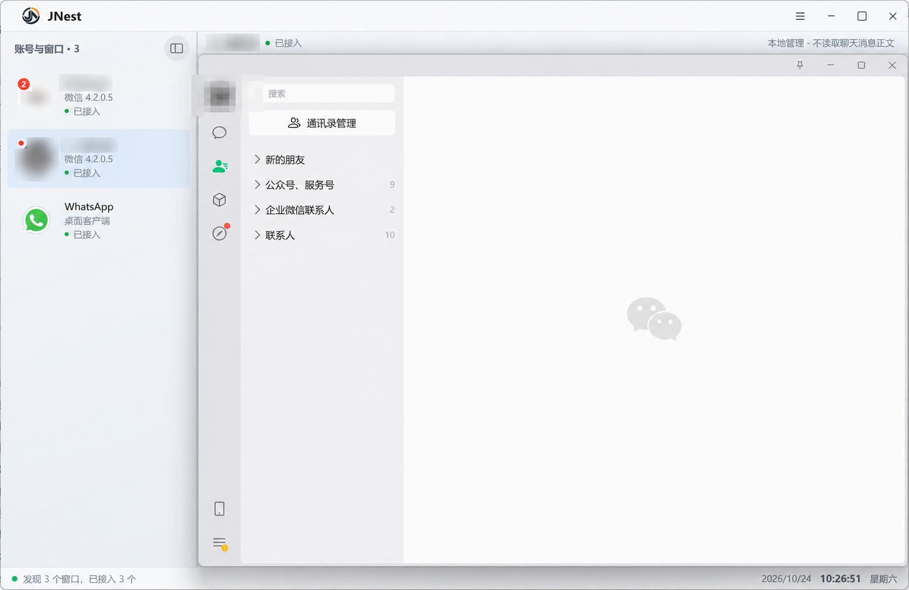
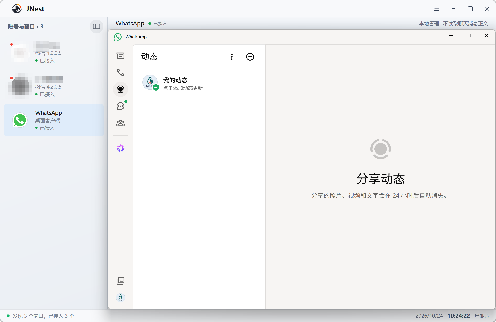
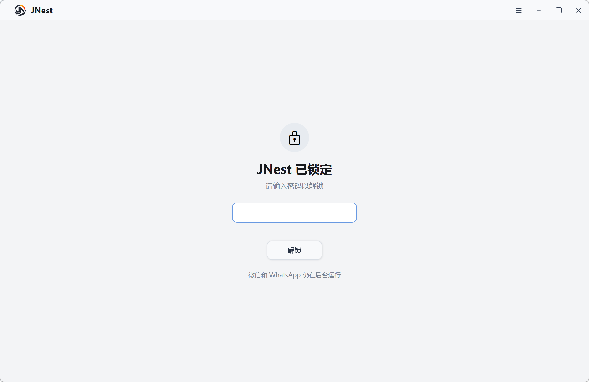

<p align="center">
  
</p>

<h1 align="center">JNest — Windows 11 微信多开与 WhatsApp 多账号窗口管理器</h1>

<p align="center">
  <strong>JNest</strong> · Windows 11 WeChat Multi-Instance & WhatsApp Desktop Window Manager
</p>

<p align="center">
  开源 · 本地运行 · 微信 4.x 多窗口管理 · WhatsApp 桌面端接入 · 多账号切换 · 未读角标提醒
</p>

<p align="center">
  <a href="https://github.com/jingjial2018-beep/JuChuang/releases">下载 JNest / Downloads</a> ·
  <a href="#主要功能">功能介绍</a> ·
  <a href="#常见问题-faq">常见问题 / FAQ</a> ·
  <a href="#隐私边界">隐私说明</a>
</p>

## JNest 是什么？（项目简介）

**JNest（聚窗）**是一款面向 **Windows 11 x64** 的开源、本地运行的 **微信多开与 WhatsApp 桌面窗口管理器**（WeChat multi-instance and WhatsApp desktop window manager）。它可以发现、启动并统一管理本机已经安装的多个微信 4.x 窗口和 WhatsApp 桌面客户端，将多个原生窗口集中到一个工作台，方便多账号切换、窗口接入、弹出与关闭。

JNest 适合需要在一台 Windows 电脑上同时管理多个微信账号或微信与 WhatsApp 桌面窗口的用户。它是**窗口管理工具**，不是新的聊天客户端、云同步服务或聊天机器人；账号登录、消息收发和聊天界面仍由微信、WhatsApp 的官方桌面程序负责。

JNest 使用 Windows WPF/Win32 机制托管窗口，并在本地识别客户端的未读角标用于提醒。**不会向第三方服务器上传聊天数据，不读取聊天消息正文，不注入微信 DLL，也不 Hook 微信内部聊天 API。**部分微信账号昵称/头像识别会按下方[隐私边界](#隐私边界)所述，只读访问本机账号元数据。

**当前正式版：** [v1.0.7](https://github.com/jingjial2018-beep/JuChuang/releases/tag/v1.0.7)（Windows 11 x64）。[查看最新正式版](https://github.com/jingjial2018-beep/JuChuang/releases/latest)可在后续发布时自动跳转；本页版本号和包名仍需随新版本手动更新。

> **源码说明：** 当前正式版对应 [v1.0.7 tag](https://github.com/jingjial2018-beep/JuChuang/tree/v1.0.7)，而默认分支 `main` 尚未同步这版程序源码。从源码构建正式版时请检出该 tag；不要将 `main` 的工程版本号当作最新发布版本。

## 软件界面

### 微信多账号统一管理

在同一界面中管理多个微信窗口，并集中查看账号状态与未读提醒。



### WhatsApp 桌面客户端接入

将 WhatsApp 桌面客户端接入 JNest，在账号列表中统一切换和查看提醒。



### 工作区密码锁

使用独立密码锁定 JNest 工作区；微信和 WhatsApp 客户端仍在后台运行。



## 主要功能

- 同时管理多个微信 4.x 窗口和 WhatsApp 桌面客户端。
- 自动扫描并接入已经打开的客户端窗口。
- 从 JNest 中启动新的微信实例或 WhatsApp。
- 已有微信运行时，优先通过短时 Mutex DACL 调整 + CreateProcessW 创建独立微信进程，并直接绑定返回 PID。
- 在左侧账号列表中快速切换窗口；右键点击账号不会切换当前账号。
- 一键将客户端弹出为原生独立窗口，也可重新接入。
- 嵌入后固定客户端位置，防止从容器内部拖动脱离。
- 关闭指定客户端时先确认，并校验 HWND、PID 与进程启动时间后结束该客户端进程；其他独立客户端进程不主动结束。
- 自动读取本地微信版本号。
- 在可可靠匹配账号时显示微信昵称和头像；正式版账号列表不提供右键功能菜单。
- 识别微信与 WhatsApp 聊天入口的未读角标，在账号头像上显示数字或红点。
- 支持 Windows 托盘提示、提示音和任务栏提醒。
- 可用独立密码锁定 JNest 工作区，并在设置页管理密码。
- 设置页支持开机自启、通知及免打扰时段；当前字体为微软雅黑 UI。
- 使用 Windows 11 风格的平面分区界面，并尽量保持客户端原生颜色与渲染效果。

## 退出方式

- **退出单个客户端：** 弹窗提供“我再想想”和“确认退出”。确认后仅针对经过身份校验的目标进程提出退出请求；进程结束可能丢失未保存内容。
- **退出 JNest：** 提供“仅退出 JNest”和“全部退出”。前者恢复被托管客户端的独立窗口并保留客户端运行；后者结束当前受管理的微信与 WhatsApp 客户端进程，不再额外弹出第二次确认。
- 退出弹窗采用与“关于 / 设置”一致的受保护模态显示流程；账号右键菜单已取消。

## 系统要求

| 项目 | 要求 |
| --- | --- |
| 操作系统 | Windows 11 x64 |
| 微信 | 微信 4.x；主要测试版本为 4.1.15.13 |
| WhatsApp | Windows 桌面客户端 |
| 轻量版运行库 | .NET 8 Desktop Runtime x64 |
| 权限 | 建议 JNest 与客户端均以普通用户权限运行 |

如果客户端以管理员身份运行，JNest 也需要使用相同权限，否则 Windows 可能阻止跨进程窗口操作。

## 下载与使用

请从 [v1.0.7 正式版发布页面](https://github.com/jingjial2018-beep/JuChuang/releases/tag/v1.0.7) 下载 Windows x64 压缩包；以后可通过[最新正式版入口](https://github.com/jingjial2018-beep/JuChuang/releases/latest)查找更新。历史测试版仅供开发追溯。不要从不明来源获取修改版程序。

| 发布包 | 适用场景 |
| --- | --- |
| `JNest-v1.0.7-FrameworkDependent-win-x64.zip` | 体积小；电脑需已安装 .NET 8 Desktop Runtime x64 |
| `JNest-v1.0.7-SelfContained-win-x64.zip` | 体积较大；无需单独安装 .NET 运行库 |

使用步骤：

1. 解压下载的压缩包。
2. 双击 `JNest.exe`。
3. 打开本地微信或 WhatsApp，JNest 会自动扫描并接入主窗口。
4. 使用标题栏菜单添加客户端、全部接入或弹出当前窗口。
5. 在左侧账号列表切换客户端。关闭账号时通过对应的关闭入口打开确认弹窗；左侧账号右键不再弹出菜单。

当前发布包未进行商业代码签名，Windows SmartScreen 可能在首次运行时显示提示。请确认文件来自本仓库的 Releases 页面后再运行。

## 常见问题 / FAQ

### JNest 支持 Windows 10、macOS 或 Linux 吗？

目前**仅面向 Windows 11 x64**，未宣称支持 Windows 10、macOS 或 Linux。

### JNest 能同时运行和管理多个微信账号吗？

JNest 支持在 Windows 11 上管理多个**微信 4.x 桌面窗口**，并提供新实例启动、自动发现、集中切换、弹出窗口等功能。能否启动或接入特定版本取决于微信客户端版本和 Windows 窗口机制；并不保证对未来所有版本均兼容。

### JNest 能管理 WhatsApp 吗？

支持接入**已安装的 WhatsApp Windows 桌面客户端窗口**，并与微信窗口一起集中切换。它不是 WhatsApp Web 包装器，也不取代官方客户端。

### JNest 可以显示未读消息数量吗？

支持基于**本机客户端界面角标**显示数字或红点，并提供任务栏提示和提示音。准确性取决于客户端界面渲染、版本及 Windows 状态；它不读取聊天正文或会话数据库。

### JNest 是否安全？会上传聊天内容吗？

JNest 作为本地窗口管理器运行，不提供聊天云同步，不向第三方服务器上传聊天数据。为识别微信昵称和头像，程序可在本地按[隐私边界](#隐私边界)所述只读访问部分账号元数据；请阅读源码、许可证和隐私说明后自行评估使用风险。

### JNest 是微信或 WhatsApp 官方软件吗？

不是。**JNest 是独立开源项目**，与腾讯、微信、WhatsApp 或 Meta 没有官方关联、授权或合作关系。

### Where can I download JNest for Windows 11?

Get the official builds from [JNest GitHub Releases](https://github.com/jingjial2018-beep/JuChuang/releases). JNest is an open-source Windows 11 desktop window manager for multiple WeChat 4.x windows and the WhatsApp desktop client. It does not replace the official messaging apps.

## 未读消息提示

JNest 不会读取聊天数据库来统计未读消息。它只截取客户端左侧导航栏的一小块画面，定位原生聊天角标并识别其中的数字：

- Windows 注意请求会触发对应账号的即时检测。微信主窗口的名称或状态变化也会通过进程外 WinEvent 触发检测；事件仅作为扫描线索，不直接代表新消息。
- 只有角标从已知无未读变为有未读，或高置信度未读数字增长时，JNest 才发出声音并闪烁任务栏；首次启动同步历史未读不会提醒。
- 程序启动后会立即校准；JNest 位于前台时每 4 秒复查所有账号。处于后台时每轮只轮流扫描一个微信账号，返回 JNest 后立即补做全量校准。
- 发现未读后立即更新账号角标；只要任一账号仍有未读，JNest 任务栏图标会持续显示一个红色标记，直到角标清除。
- 角标消失需要连续两次确认，避免客户端重绘时误清零。
- 高置信度结果显示数字，超过 99 显示 `99+`；无法可靠识别时显示红点。
- WhatsApp 会区分聊天角标与通话角标，通话、状态和归档提醒不会计入聊天未读数。

Windows 不提供可按微信 PID 可靠订阅的跨进程托盘图标修改事件；纯托盘活动不会直接触发扫描。JNest 使用 Shell 注意请求、后台轮询及返回前台时的校准补漏。若截图不可用，本地诊断日志会记录降级状态；发出任务栏闪烁请求时也会记录。Windows 的“显示任务栏应用闪烁”设置可能抑制闪动，持续未读标记可作为补充。整个过程不向微信注入 DLL、不 Hook 微信 API，也不更改微信配置。

客户端界面升级后，角标的位置、颜色或字体可能改变。出现识别异常时，请在 Issue 中附上客户端版本、Windows 缩放比例和已遮挡聊天内容的界面截图。

## 隐私边界

JNest 在本机运行，不提供云端服务，也不读取或上传消息正文。

为了区分多个微信账号，程序可能执行以下只读操作：

- 读取微信进程路径和文件版本。
- 将微信进程与本地账号目录进行匹配。
- 以只读方式（`PROCESS_VM_READ`）读取对应微信进程的内存，定位当前账号 `contact.db` 的 SQLCipher 解密密钥。该操作只针对微信进程，不写入、不注入；部分安全软件可能会对“读取其他进程内存”的行为给出提示。
- 用该密钥解密 `contact.db` 的临时副本，只查询当前账号自己的昵称与头像元数据。需要说明的是，临时副本是整个 `contact.db` 的解密结果（其中可能包含联系人信息），程序只查询本人资料行，不读取其他内容。
- 从该账号 `temp/head_image` 与共享 `all_users/head_imgs` 中查找本地头像缓存。
- 当明文头像缓存尚未生成时，可只读解密当前账号的 `db_storage/head_image/head_image.db`，仅提取当前账号自己的头像 BLOB。

程序不会查询消息、会话、朋友圈等数据库，不会通过网络下载头像。数据库密钥只保存在内存中，读取结束后清零，不写入磁盘。临时解密副本存放在 `%LOCALAPPDATA%\JuChuang\tmp\profile`（仅当前用户和 SYSTEM 可访问），读取完成后立即删除；若程序异常退出留下残留，下次启动时会自动清理。未读角标识别只处理客户端导航栏截图，不解析聊天内容。

## 界面与窗口托管说明

JNest 通过 Win32 和 WPF 管理外部客户端窗口。嵌入状态下会同步客户端的位置、尺寸、可见区域和激活状态；弹出时恢复客户端原生窗口样式。

微信图片、视频、文件预览和内置网页等辅助窗口不会作为账号主窗口接入。若客户端更新后改变窗口类名、渲染结构或安全策略，可能需要同步更新发现与托管规则。

## 从源码构建

准备环境：

- Windows 11 x64
- .NET 8 SDK
- Visual Studio 2022（可选，需安装 .NET 桌面开发组件）

构建前先检出正式版源码（在本仓库的本地副本中）：

```powershell
git checkout v1.0.7
dotnet build .\JuChuang.csproj -c Release
```

运行角标识别回归测试：

```powershell
dotnet run --project .\Tests\BadgeProbe\JuChuang.BadgeProbe.csproj -c Release
```

启动不接管本地客户端的界面预览模式：

```powershell
dotnet run --project .\JuChuang.csproj -- --preview
```

生成轻量版：

```powershell
dotnet publish .\JuChuang.csproj -c Release -r win-x64 `
  --self-contained false `
  -p:PublishSingleFile=true `
  -p:PublishReadyToRun=true
```

生成免运行库版：

```powershell
dotnet publish .\JuChuang.csproj -c Release -r win-x64 `
  --self-contained true `
  -p:PublishSingleFile=true `
  -p:PublishReadyToRun=true `
  -p:IncludeNativeLibrariesForSelfExtract=true
```

## 项目结构

```text
JuChuang/
├─ Assets/                    应用图标与客户端图标
├─ Controls/                  外部窗口托管控件
├─ docs/images/               GitHub 项目介绍截图
├─ Models/                    客户端窗口与界面状态模型
├─ Services/                  窗口发现、启动、资料读取和角标识别
├─ Tests/BadgeProbe/          未读角标识别回归测试
├─ Tests/ArchitectureProbe/   账号/窗口架构回归测试
├─ MainWindow*.cs             主窗口、通知、托盘和角标调度
├─ MainWindow.xaml            主界面
└─ JuChuang.csproj            .NET 项目文件
```

## 版本记录

| 正式版 | 主要变化 |
| --- | --- |
| [v1.0.7](https://github.com/jingjial2018-beep/JuChuang/releases/tag/v1.0.7) | 保留微软雅黑 UI，统一设置页字号、说明文字与按钮排版。 |
| [v1.0.6](https://github.com/jingjial2018-beep/JuChuang/releases/tag/v1.0.6) | 修正账号列表右键误切换；延续密码锁与模态窗口改进。 |
| [v1.0.5](https://github.com/jingjial2018-beep/JuChuang/releases/tag/v1.0.5) | 优化设置页与托盘菜单交互。 |
| [v1.0.4](https://github.com/jingjial2018-beep/JuChuang/releases/tag/v1.0.4) | 完善设置页、通知免打扰、菜单图标和星期显示。 |
| [v1.0.3](https://github.com/jingjial2018-beep/JuChuang/releases/tag/v1.0.3) | 完善客户端退出与 JNest 退出方式。 |

完整更新内容及更早版本见 [Releases](https://github.com/jingjial2018-beep/JuChuang/releases)。历史版本记录保留在 [v1.0.7 源码中的 README](https://github.com/jingjial2018-beep/JuChuang/blob/v1.0.7/README.md#版本记录)；其中过往设计、测试与限制不代表当前正式版状态。

## 已知限制

- 当前仅面向 Windows 11 x64。
- 客户端升级可能改变窗口结构、昵称资料格式或角标样式。
- 跨进程窗口托管依赖 Windows 桌面窗口机制，部分特殊版本可能拒绝接入。
- 硬件加速窗口在少数显卡驱动或远程桌面环境中可能出现截图失败，此时未读提示会回退为红点或不显示。
- 微信本地资料结构变化时，昵称和头像会安全回退到通用名称与默认图标，不影响窗口管理。

## 开源许可证

Copyright 2026 JINGJIA LI

本项目采用 [Apache License 2.0](LICENSE) 授权。你可以使用、修改、分发和商用本项目，但必须遵守许可证中的版权声明保留、修改说明等条件。

## 第三方说明与免责声明

微信账号资料的只读解析参考了第三方公开研究，详情见 [THIRD-PARTY-NOTICES.md](THIRD-PARTY-NOTICES.md)。

本项目是非官方桌面工具，与腾讯、微信、WhatsApp 或 Meta 无隶属、授权或合作关系。使用者应自行遵守客户端服务条款、当地法律和所在组织的信息安全要求。
