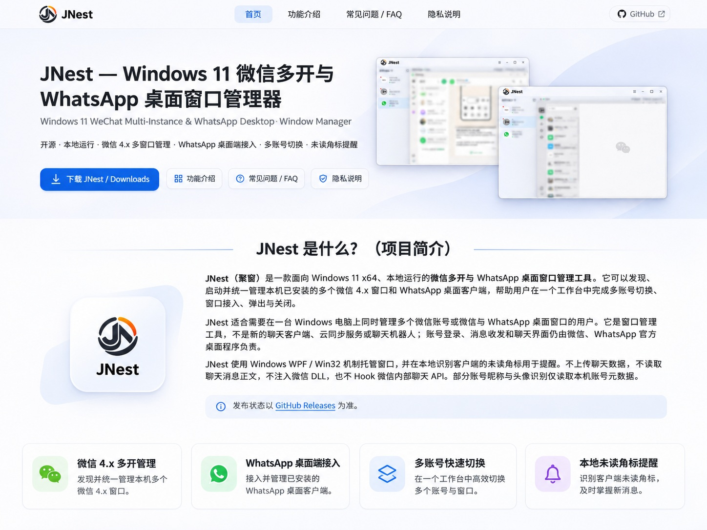

<p align="center">
  
</p>

<h1 align="center">JNest · 聚窗</h1>

<p align="center">Windows 11 上的微信 4.x 多开与 WhatsApp 桌面窗口管理器</p>

<p align="center">
  <a href="https://github.com/jingjial2018-beep/JuChuang/releases/latest">下载最新版</a> ·
  <a href="https://github.com/jingjial2018-beep/JuChuang/releases">查看历史版本</a> ·
  <a href="#从源码构建">从源码构建</a>
</p>



JNest 是面向 **Windows 11 x64** 的开源桌面工具。它发现并管理本机已安装的微信 4.x 和 WhatsApp 桌面客户端，将原生窗口集中在一个工作区，方便同时使用多个微信账号、切换窗口和查看未读提醒。登录、聊天和消息收发仍由各客户端完成。

## 主要功能

- **微信 4.x 多开：** 发现已运行的微信窗口，也可从 JNest 启动新的微信实例。
- **统一管理：** 将微信和 WhatsApp 桌面窗口接入工作区，在左侧账号列表中切换、排序；需要时可将窗口弹出并重新接入。
- **本地未读提醒：** 根据客户端界面的聊天角标显示数字或红点，配合提示音、任务栏与托盘提示。识别结果取决于客户端版本和界面状态。
- **工作区密码锁：** 锁定 JNest 界面；密码和锁定状态只在当前进程会话内有效。它不会锁定微信或 WhatsApp 客户端本身。
- **日常设置：** 支持开机自启、通知和免打扰时段。

## 下载与使用

从 [最新正式版](https://github.com/jingjial2018-beep/JuChuang/releases/latest) 获取 Windows x64 压缩包。当前正式版为 [v2.0.4](https://github.com/jingjial2018-beep/JuChuang/releases/tag/v2.0.4)；其他正式版见[历史发布列表](https://github.com/jingjial2018-beep/JuChuang/releases)，需要固定回滚版本时可查看 [v1.0.10 Final](https://github.com/jingjial2018-beep/JuChuang/releases/tag/v1.0.10)。

| 发布包 | 运行要求 |
| --- | --- |
| [SelfContained](https://github.com/jingjial2018-beep/JuChuang/releases/download/v2.0.4/JNest-v2.0.4-SelfContained-win-x64.zip) | 自带 .NET 运行时，普通用户优先选择 |
| [FrameworkDependent](https://github.com/jingjial2018-beep/JuChuang/releases/download/v2.0.4/JNest-v2.0.4-FrameworkDependent-win-x64.zip) | 需预先安装 .NET 10 Desktop Runtime x64 |

解压后运行 `JNest.exe`，打开本机微信或 WhatsApp 桌面客户端，JNest 会扫描并接入主窗口。通过左侧列表切换账号，通过窗口菜单添加、接入或弹出客户端。两个 ZIP 的 SHA-256 校验值见 [v2.0.4 发布说明](https://github.com/jingjial2018-beep/JuChuang/releases/tag/v2.0.4)。

JNest 建议与客户端以相同的普通用户权限运行；若客户端以管理员身份运行，跨进程窗口操作也可能要求 JNest 使用相同权限。发布包尚未进行商业代码签名，首次运行若出现 Windows SmartScreen 提示，请核对下载来源和发布说明中的哈希。

## 隐私与技术边界

JNest 使用 WPF 和 Win32 在本机管理客户端窗口，不提供聊天云同步服务，也不负责账号登录或消息收发。它不注入微信 DLL，不 Hook 微信内部聊天 API。

**未读提醒**通过在内存中截取客户端窗口画面，并分析导航栏的聊天角标区域实现。整窗画面可能短暂包含聊天内容，但截图不写入磁盘，识别逻辑不解析消息正文或会话数据库。客户端界面变化、硬件加速或远程桌面环境可能使角标无法识别。

**微信昵称与头像**的识别需要访问本机账号资料：程序可能只读读取微信进程内存中的数据库密钥，解密 `contact.db` 的临时副本，并仅查询当前账号的本人资料行；必要时还会读取本地头像缓存或头像数据库。临时副本可能包含联系人资料，正常读取后会删除；异常退出时可能残留，后续启动或读取时会尝试清理。程序不查询消息、会话或朋友圈数据库，不通过网络下载头像。若资料识别失败，会回退到通用名称和默认图标，窗口管理仍可使用。

完整的权限、临时文件与清理说明请阅读[隐私边界与实现细节](#隐私边界与实现细节)。

## 系统要求与已知限制

- 仅面向 Windows 11 x64；需要本机安装微信 4.x 或 WhatsApp Windows 桌面客户端。
- 客户端升级可能改变窗口结构、账号资料格式或角标样式，影响接入和未读识别。未来版本兼容性不作保证。
- 固定 100% 和 200% DPI 缩放下的冷启动已验证；运行中改变显示缩放比例可能造成窗口边框错位。
- JNest 是独立开源项目，与腾讯、微信、WhatsApp 或 Meta 没有官方关联。

## 从源码构建

需要 Windows 11 x64 和 .NET 10 SDK。仓库的开发基线是 [`stable`](https://github.com/jingjial2018-beep/JuChuang/tree/stable)，协作约定见 [AGENTS.md](AGENTS.md)。

```powershell
dotnet build .\JuChuang.csproj -c Release
dotnet run --project .\Tests\ArchitectureProbe\JuChuang.ArchitectureProbe.csproj -c Release
dotnet run --project .\Tests\BadgeProbe\JuChuang.BadgeProbe.csproj -c Release
dotnet run --project .\Tests\RegressionProbe\JuChuang.RegressionProbe.csproj -c Release
.\Tests\ValidateSettingsTypography.ps1
```

不接管本地客户端的界面预览模式：

```powershell
dotnet run --project .\JuChuang.csproj -- --preview
```

更多版本变化见 [Releases](https://github.com/jingjial2018-beep/JuChuang/releases) 和 [RELEASE_NOTES.md](RELEASE_NOTES.md)。

## 隐私边界与实现细节

微信资料识别会将进程与本地账号目录匹配，以 `PROCESS_VM_READ` 只读获取当前账号 `contact.db` 的 SQLCipher 密钥。临时解密副本位于 `%LOCALAPPDATA%\JuChuang\tmp\profile`；读取前会检查目录权限，不能收紧到当前用户与 SYSTEM 时停止资料读取。密钥只保留在内存中，使用后清零，不写入磁盘。正常完成后删除临时副本；异常退出后的清理由后续运行处理，不能保证立即删除。头像可来自当前账号的 `temp/head_image`、共享 `all_users/head_imgs`，或只读解密的 `db_storage/head_image/head_image.db`。

窗口托管依赖 Windows 桌面窗口机制。微信图片、视频、文件预览和内置网页等辅助窗口不会作为账号主窗口接入。未读角标只在本机分析，不向第三方服务器上传聊天数据。

## 许可证与声明

Copyright 2026 JINGJIA LI。项目采用 [Apache License 2.0](LICENSE)。第三方研究引用见 [THIRD-PARTY-NOTICES.md](THIRD-PARTY-NOTICES.md)。使用时请遵守客户端服务条款、当地法律及所在组织的安全要求。
